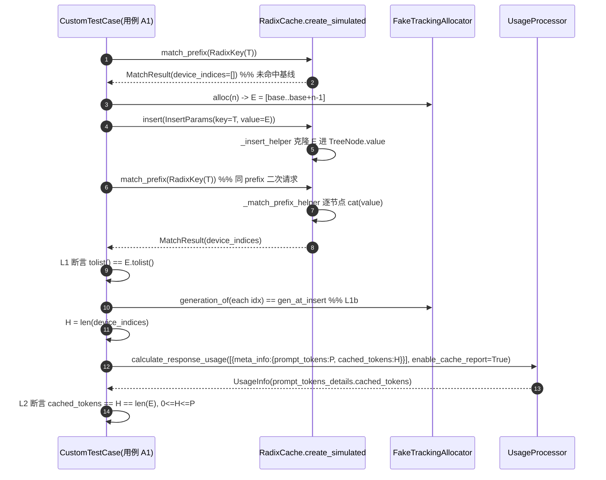
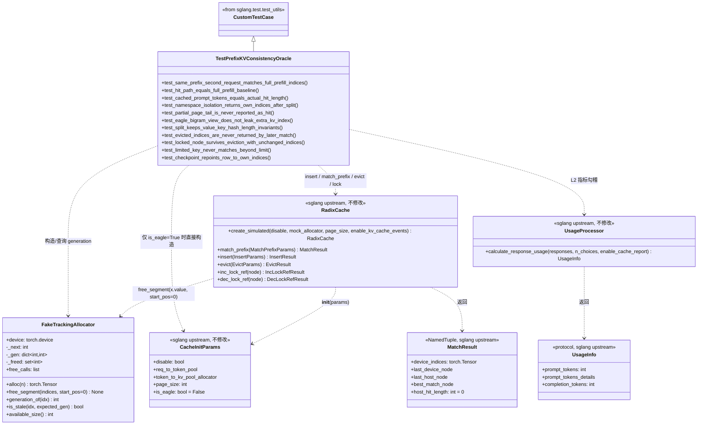
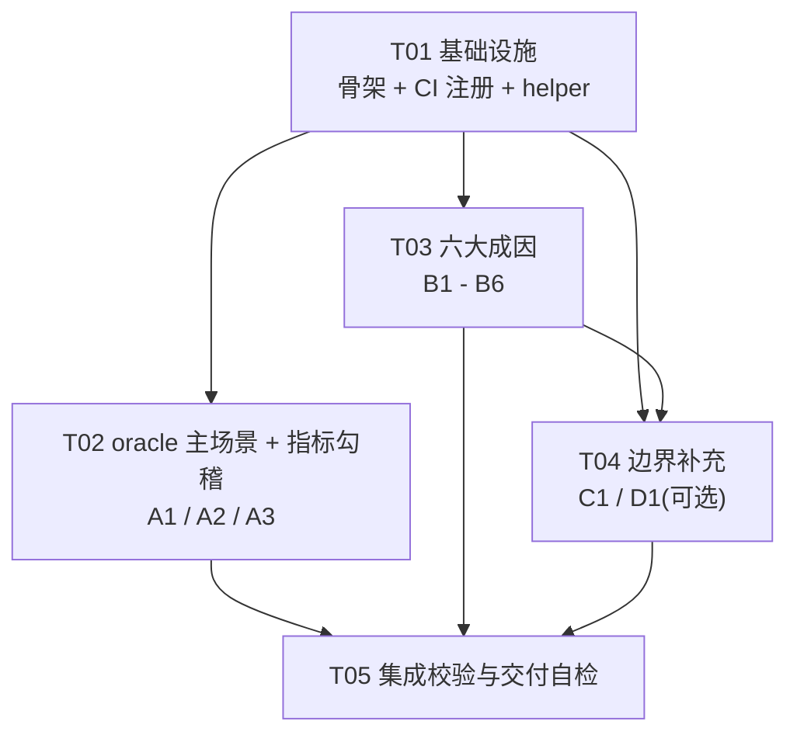

# 前缀缓存 KV 一致性 oracle 测试覆盖设计

| 项 | 内容 |
| --- | --- |
| 阶段 | 阶段 1：测试方案设计 + 任务分解（不含实现） |
| 交付人 | 高见远（架构师 / software-architect） |
| 派发人 | 齐活林（主理人 / team-lead） |
| 日期 | 2026-11-12 |
| 仓库 | `D:/Develop/sglang-v100`（上游 sglang 的 Volta/SM70 专用 fork） |
| 落地人 | 严过关（QA 工程师 / software-qa-engineer），阶段 2 |
| 用户需求原文 | 「现在就是发现出现前缀缓存一致性问题：前缀缓存最危险的失败模式是命中了错误的 KV 但服务照常应答，输出静默劣化。你来补充这个测试覆盖」 |

---

## 0. 证据分级约定（全文遵守）

本文所有结论按以下三级标注，**任何地方都不得声称测试已通过**：

- **【已验证事实】**：本阶段通过 `Read` / `Grep` 实际核对过的仓库内容，附带 `文件:行号`。可直接采信。
- **【设计预期】**：基于已验证事实推导出的设计判断、接口契约、期望断言行为。**尚未执行、尚未验证**，必须在本机以外的 4×V100 目标机 env 内解释器下由阶段 2/3 验证。
- **【待决策】**：需要主理人或用户拍板，见第 8 节。

> **本机（Windows 开发机）约束**【已验证事实，来自主理人输入】：没有 `$HOME/miniconda3/envs/sglang-v100`，没有 `torch` / `pytest` / `sglang`。因此本阶段**无法实际执行任何测试**，也无法验证任何断言的真伪。本文全部「期望值」均为设计预期。

> **交付边界**：本阶段只产出设计说明与任务分解，**不编写、不修改任何测试代码或实现代码**。下文第 5 节出现的代码片段均为**接口契约与构造示意（伪代码，不可直接运行）**，用于向 QA 说明字段与最小接口，落地实现由阶段 2 完成。本次不新建任何 `.py` 文件，不改动 `python/sglang/**` 任何上游文件。

---

## 1. 一致性 oracle 的可执行定义

### 1.1 权威判据

【已验证事实】`AGENTS.md:84`「数值验证纪律」表格，前缀缓存一行原文：

> 同 prefix 请求 `cached_prompt_tokens` 提升 + 输出与全量 prefill 一致

【已验证事实】`AGENTS.md:37-39` 同构陷阱：

> 上游 Marlin MoE 内核在 sm80 以下是空壳——缺 V100 内核的服务会正常启动、正常应答、但专家输出全零……不得把「启动成功/有输出」当作内核正确的证据。

用户描述的「命中了错误的 KV、服务仍正常应答、输出静默劣化」正是同一类风险在**缓存层**的体现。因此本次守卫的设计原则必须是：**不看「服务有没有回答」，只看「回答所依赖的 KV 身份是否与全量 prefill 完全一致」**。

【已验证事实】`test/registered/unit/README.md:95-97` 硬性规则：

> Mock external or slow dependency boundaries only when the assertion still checks a result, state transition, protocol output, or error. A test that proves only that its mock was called is not sufficient.

即：**禁止 `assert_called()` 式弱断言**，必须断言结果、状态转换、协议输出或错误。

### 1.2 核心难题的明确回答：`device_indices` 代理是否充分

主理人初步想法：把 `MatchResult.device_indices`（KV 索引序列）作为输出代理 oracle —— 命中路径返回的 indices 必须与「全量 prefill 逐 token 写入」的期望 indices 逐位一致。

**结论：该代理在「缓存层」是充分（近乎充要）的，但必须配 L1b + L2 两层补充才闭环；不建议再加 mock attention logits 比对。**

#### 为什么充分（缓存层）

【已验证事实】`radix_cache.py:415-435`（`insert`）、`radix_cache.py:637-661`（`_match_prefix_helper`）、`radix_cache.py:403-413`（`match_prefix`）：

- `insert` 把 `value`（KV slot 索引的 `int64` tensor）`clone()` 进树节点（`:736`）；
- `match_prefix` 沿命中路径把各节点的 `value` 用 `torch.cat` 拼成 `MatchResult.device_indices`（`:404-409`）；
- 下游 attention 正是拿这组 indices 去 KV pool gather K/V。

因此：**`device_indices` 逐位一致 ⇒ gather 到完全相同的一组 KV slot ⇒ 在 KV 内容未被污染的前提下，输出必然与全量 prefill 一致**。它是缓存层「输出一致」的可执行化身，且能同时覆盖两类失败：

| 失败形态 | 表现 | 逐位断言结果 |
| --- | --- | --- |
| 未命中（缓存失效） | `len(device_indices)` 变短 / 为 0 | FAIL（长度即不等） |
| 命中了但内容错（串扰/错位/陈旧索引） | `len` 可能正确，但值来自别的序列 | FAIL（值不等） |

两者被**同一条断言**覆盖，且失败信息中带上 `device_indices.tolist()` 与期望序列，可直接区分是「没命中」还是「命中错段」。

**关键构造（使代理具备鉴别力）**：不能像现有测试那样用 `[10,20,30]` 这类与 token 同构、跨序列可能重叠的数值【已验证事实：`test_radix_cache_unit.py:612-656`】。必须给**每条序列分配全局唯一、互不重叠、位置编码**的索引空间：

```
E(seq_id, n) = [seq_id * BASE + i for i in range(n)]     # BASE 取足够大，如 10000
```

`E` 即「全量 prefill 逐 token 写入的期望 KV 索引」。任何错位（命中到另一个 namespace / 另一分支 / 越界的尾部页 / 已释放的旧 slot）都会引入另一个 `seq_id` 段的数值，逐位比对必然 FAIL。这把「静默劣化」变成了**非静默的、带完整序列诊断信息的失败**。

#### 盲区与缓解（诚实清单）

| # | 盲区 | 能否纯 CPU 单测覆盖 | 缓解手段 |
| --- | --- | --- | --- |
| B-1 | indices 序列正确，但 **KV pool 里该 slot 的实际内容已被别的 token 覆盖**（allocator free 后 slot 复用）。Simulated cache 的 `value` 是 `.clone()` 的 tensor，本身不会变 | **可以（用 L1b）** | **L1b generation 账本**：fake allocator 为每个 index 记 generation，`free_segment` 时递增；断言 match 返回的每个 index 的 generation 必须等于其插入时的 generation |
| B-2 | 指标 `cached_prompt_tokens` 与实际命中长度脱节（「指标说命中了，indices 却是错的」的假绿） | **可以（用 L2）** | **L2 跨层勾稽**：上报值不由测试硬编码，而是由 `len(device_indices)` 推导后灌入 usage 链，再断言协议输出等于它 |
| B-3 | HiCache L2/L3（`SGLANG_HICACHE_FILE_BACKEND_STORAGE_DIR` 指向磁盘）加载回来的 KV 内容错 | **不能** | 留 E2E / 多卡；本次不覆盖，见 8.4 |
| B-4 | 真实 attention kernel 数值错（`AGENTS.md:37-39` 的「专家输出全零」） | **不能** | `bash scripts/smoke_v100.sh` + 4×V100 上 temperature=0 双请求文本/logprobs 对齐；纯 CPU 单测**不得**声称已验证「输出一致」 |
| B-5 | MTP/Eagle 投机路径 accept ~2.1 与输出一致性 | **不能** | AGENTS.md:83 的 MTP oracle，target-only vs `--spec` 双模式 E2E；本次只覆盖 bigram 视图在缓存层的索引一致性（用例 B3） |

#### 为什么**不**加「mock 一次极小 attention reduce 比对 logits」

【设计预期】理由三条：

1. 一个测试自己写的 `reduce` 当 oracle，**没有独立权威性**，容易变成自证循环（fake 与被测逻辑同错即绿）；
2. `README.md:95-97` 明确「只证明 mock 被调用的测试不算数」，mock attention 的 logits 比对极易滑向「我 mock 了，我比了，所以对了」的弱断言；
3. 真正的「输出与全量 prefill 一致」必须在 4×V100 上用真实内核产生，属于 E2E 契约（见 7.3），不应在 CPU 单测里伪造等价物。

**替代方案（更好）**：用 **L1b 的 generation 账本**把「indices 对但内容被覆盖」这一最隐蔽的静默劣化变成可断言的**状态转换**，而不是去伪造数值 forward。这既符合 README 对「state transition」的偏好，又不需要任何 GPU 依赖。

### 1.3 三层可执行断言（最终定义）

| 层 | 名称 | 断言对象 | 作用 |
| --- | --- | --- | --- |
| **L1** | 命中路径索引逐位一致 | `MatchResult.device_indices` vs `E[:L]` | 主 oracle，抓「命中错 KV / 未命中」 |
| **L1b** | 索引生命周期 generation | fake allocator 的 `generation_of(idx)` | 补 B-1，抓「陈旧/被复用 slot」 |
| **L2** | 指标与命中长度勾稽 | `UsageInfo.prompt_tokens_details.cached_tokens` == `len(device_indices)` | 补 B-2，落实 oracle 前半句「`cached_prompt_tokens` 提升」 |

**「提升」在纯 CPU 单测的可执行化身**【设计预期】：真实服务里「提升」是两次跨请求比较；单测里把它拆成两个可断言事实——
1. 空树首次 `match_prefix` 返回 `len == 0`（未命中）；
2. `insert` 后二次 `match_prefix` 返回完整 `E`（命中），且 `H = len(device_indices) > 0`；
3. `H` 灌入 usage 链后，协议输出里的 `cached_tokens == H`（指标与实际命中绑死）。

三者串起来即「同 prefix 请求命中提升 + 命中内容与全量 prefill 一致」，见用例 A1 / A3 与下方时序图。

### 1.4 调用流（Mermaid sequenceDiagram）



---

## 2. 失败模式 → 用例映射表

### 2.1 对主理人给出的 8 类成因的处置结论

【已验证事实：逐条核对 `test_radix_cache_unit.py` 全部 38 用例】现有覆盖情况与空白：

| 主理人成因 | 现有覆盖（已验证） | 本次处置 |
| --- | --- | --- |
| 1 命名空间串扰 | `test_extra_key_isolation`（:604）、`test_cache_salt_isolation_is_independent_of_extra_key`（:661）已在 **page_size=1、无分裂**下用不同 value 断言了 indices | **升级**为 page_size>1 + 分裂后 + extra_key/cache_salt 双向交叉；不重复基础情形 |
| 2 page_size 对齐边界 | `test_page_alignment_boundary`（:850）**只断言 `match_len % page_size == 0` 与 `>0`，完全不检查 indices 内容**；`test_match_page_size_gt_1_rounds_down`（:221）是纯 `RadixKey.match` 数据结构测试 | **重点空白**，升级为内容级守卫 |
| 3 bigram / Eagle(MTP) | `test_match_bigram`（:249）只测 `RadixKey.match`；**全仓 unit/mem_cache 未见 `RadixCache` 的 `is_eagle=True` 路径** | **重点空白** |
| 4 节点分裂 | `test_advanced_prefix_match_with_node_splits`（:880）已断言 indices 内容；`test_hash_value_split`（:992）、`test_cache_salt_event_hashes_are_preserved_across_node_split`（:753）断言 hash 拼接/页数 | **补不变量**：`len(value)==len(key)`、hash 页数与 key 长度绑定，分裂后重验 indices |
| 5 evict 后索引复用 | `test_evict_functionality`（:814）**只断言 `mock_allocator.free_segment.assert_called()` 与 `total_size` 减少** —— 正是 README:95-97 禁止的弱断言；`test_finished_request_splits_prompt_from_output_for_eviction`（:469）evict 后只断言长度 | **重点空白**，升级为状态转换 + indices 内容 + generation |
| 6 lock_ref 并发 | `test_lock_ref_operations`（:783）只断言 `evictable_size` / `protected_size` 计数；`test_decode_radix_lock_ref.py` 测的是 disagg 场景的 lock 平衡，不是驱逐保护 | **重点空白**，升级为「驱逐压力下锁定路径 indices 不变」 |
| 7 `limit` 零拷贝切片 | **核查偏差**：`test_radix_cache_unit.py` 38 用例中**未见 `RadixKey(..., limit=...)` 构造**（`Grep "limit\s*="` 在 `test/registered/unit/` 下命中均属其他模块）；已覆盖的是 `__getitem__` 切片（:176），非 `limit` 字段 | 降为 **P1**，且只在 `insert`/`match_prefix` 路径上测一致性，不与数据结构行为重复 |
| 8 指标层 `cached_prompt_tokens` | **零测试文件引用**（`Grep cached_prompt_tokens` 全仓仅命中 `AGENTS.md:84`、`docs/v100/*`、`metrics_collector.py`、`anthropic/serving.py`、`scripts/p0_trace_probe.py`） | **本次核心新增**；但注意 `test_serving_chat.py:4129` 已测上报链路本身（硬编码 6），本次测的是**跨层勾稽**，不重复 |

### 2.2 映射表

> 全部用例均为纯 CPU 可行性 = ✅（依赖 `torch` CPU tensor，不启动服务、不加载权重、不需要 CUDA）。优先级 P0 为必做。

| # | 成因 | 用例名 | 断言（强断言，均为结果/状态/协议输出） | 纯 CPU | 优先级 |
| --- | --- | --- | --- | --- | --- |
| A1 | oracle 主场景 | `test_same_prefix_second_request_matches_full_prefill_indices` | 首次 match 为空；二次 match `device_indices.tolist() == E.tolist()`；`H=len(...)>0` | ✅ | **P0** |
| A2 | 全量 prefill 差分 | `test_hit_path_equals_full_prefill_baseline` | 参数化 page_size∈{1,4,8}×多序列，命中路径逐位 == 直接构造的 `E[:L]` 基线；`L % page_size == 0` | ✅ | **P0** |
| A3 | **成因 8** 指标脱节 | `test_cached_prompt_tokens_equals_actual_hit_length` | `cached_tokens == len(device_indices)`（H 由 indices 推导）；`0<=H<=P`；`input_tokens == P-H`；H=0 时 details 为 None | ✅ | **P0** |
| B1 | **成因 1** 命名空间串扰 | `test_namespace_isolation_returns_own_indices_after_split` | 分裂后每个 namespace 的 indices 逐位 == 自己的 E；结果不含对方 base 段任何 index | ✅ | **P0** |
| B2 | **成因 2** page 对齐边界 | `test_partial_page_tail_is_never_reported_as_hit` | 非整页尾部：`len == floor(n/page)*page`，逐位 == `E[:L]`，且 `E[L]`/`E[n-1]` 不出现在结果里 | ✅ | **P0** |
| B3 | **成因 3** bigram/Eagle | `test_eagle_bigram_view_does_not_leak_extra_kv_index` | `is_eagle=True` 时命中长度 == `(n-1)` page_aligned，逐位 == `E[:L]`，`E[n-1]` 不出现；与非 eagle 对照长度差明确 | ✅ | **P0** |
| B4 | **成因 4** 节点分裂 | `test_split_keeps_value_key_hash_length_invariants` | 分裂后每个非 root 节点 `len(value)==len(key)`、`len(hash_value)==len(key)//page_size`；父子 hash 拼接 == 原 hash；再次 match 逐位 == E | ✅ | **P0** |
| B5 | **成因 5** evict 后索引复用 | `test_evicted_indices_are_never_returned_by_later_match` | evict 后 fake allocator 中对应 index 的 generation 递增；后续 match 不返回任何 generation 已变的 index | ✅ | **P0** |
| B6 | **成因 6** lock_ref 并发 | `test_locked_node_survives_eviction_with_unchanged_indices` | 加锁后全额 evict：锁定路径 indices 逐位不变、generation 未变；`protected_size >= len(E)` | ✅ | **P0** |
| C1 | **成因 7** `limit` 视图 | `test_limited_key_never_matches_beyond_limit` | `limit=k` 的 key：命中长度 <= k 且逐位 == `E[:L]`，不含 `E[k:]` 任何 index | ✅ | P1 |
| D1 | checkpoint 行重指向 | `test_checkpoint_repoints_row_to_own_indices`（可选） | `req.prefix_indices` 与 tree 的 E 一致；`req_to_token` 行被重指向；无 stale index | ✅（需确认依赖） | P2 |

### 2.3 增删说明（相对主理人给的 8 条）

- **新增 A1 / A2**：`AGENTS.md:84` 判据主语是「同 prefix 请求」，必须有一个把「提升 + 一致」串成完整可执行场景的用例，否则只是零散单点。A2 提供参数化的「命中路径 vs 全量 prefill 基线」差分，是主 oracle 的可复用底座。
- **成因 1 降级为基础已覆盖、升级为分裂后**：避免与 `test_extra_key_isolation` 重复。
- **成因 7 降 P1**：`limit` 属数据结构行为，本次只在 cache 路径上测一致性，不与 `__getitem__` 切片测试重复。
- **新增 D1 为可选 P2**：`checkpoint` 需要 fake `Req` / `ReqKvInfo` / `req_to_token_pool`，依赖较重，见 5.4。
- **明确不覆盖**（必须留给 E2E）：真实 logits/文本一致性、HiCache L2/L3 加载内容、MTP accept 与投机输出、`smoke_v100.sh` 零输出检测。见 7.3 与 8.4。

---

## 3. 测试用例矩阵

> 记号：`T` = token 序列（`array('q', ...)`）；`E = _indices(base, n)` = 全量 prefill 期望 KV 索引；`L` = 期望命中长度（page_aligned 后）；`page` = `page_size`。
> 所有「逐位比对」统一用 `actual.tolist() == expected.tolist()`（失败信息自带完整序列，便于区分「没命中」与「命中错段」），并额外断言 `dtype == torch.int64` 与 `device.type == "cpu"`。
> 以下全部为【设计预期】。

### 组 A — oracle 主场景与指标勾稽

#### A1 `test_same_prefix_second_request_matches_full_prefill_indices`（P0）

| 项 | 内容 |
| --- | --- |
| 输入构造 | `page=1`；`T = [7,8,9,...,16]`（n=10）；`E = _indices(base=1000, 10)`；空树 |
| 关键步骤 | ① `m1 = match_prefix(T)` → 未命中基线；② `insert(T, E)`；③ `m2 = match_prefix(T)` → 同 prefix 二次；④ `H = len(m2.device_indices)` |
| 期望值 | `m1.device_indices` 长度 0；`m2.device_indices.tolist() == E.tolist()`（全 10 位）；`H == 10 > 0` |
| 断言方式 | `assertEqual(m1.device_indices.tolist(), [])`；`_assert_indices_equal(m2.device_indices, E)`；`assertEqual(H, len(E))`；`assertGreater(H, 0)` |
| 意义 | 把 `AGENTS.md:84` 整句判据落成一个可执行场景，是全部守卫的金丝雀 |

#### A2 `test_hit_path_equals_full_prefill_baseline`（P0）

| 项 | 内容 |
| --- | --- |
| 输入构造 | `subTest` 参数化 `page ∈ {1,4,8}` × `n ∈ {6,9,16}`；主序列 `T`（`E_A`, base=2000）；分支序列 `T[:d] + 不同后缀`（`E_B`, base=5000，d 为分叉点）；query 集合 = {全匹配、部分匹配、分叉后} |
| 关键步骤 | 插入主 + 分支 → 对每个 query 取 `match_prefix` → 直接构造「全量 prefill 基线」`E_x[:L]`（**不经过 cache**） |
| 期望值 | 每次 `L == floor(shared_len/page)*page`；`device_indices.tolist() == E_x[:L].tolist()`；`L % page == 0` |
| 断言方式 | 逐位比对 + `assertEqual(L % page, 0)`；每个 `subTest` 带上 `(page, n, d, query)` 标识 |
| 意义 | 差分底座：命中路径必须等于「不经过缓存的全量写入」，不受缓存拓扑影响 |

#### A3 `test_cached_prompt_tokens_equals_actual_hit_length`（P0，成因 8）

| 项 | 内容 |
| --- | --- |
| 输入构造 | 参数化 4 场景：全命中 / 部分命中 / 零命中 / 命名空间隔离命中；`P = len(T)`；`H` **由 `len(match_prefix(...).device_indices)` 推导，不硬编码** |
| 关键步骤 | 取 `m` → `H = len(m.device_indices)` → 构造 `responses=[{"meta_info": {"prompt_tokens": P, "cached_tokens": H, "completion_tokens": 1}}]` → `UsageProcessor.calculate_response_usage(responses, n_choices=1, enable_cache_report=True)` → 再走 `anthropic.serving._cached_prompt_tokens(usage)` / `_anthropic_usage_from_openai(usage, include_input=True, include_output=True)` |
| 期望值 | `usage.prompt_tokens_details.cached_tokens == H == len(m.device_indices)`；`usage.prompt_tokens == P`；`0 <= H <= P`；`input_tokens == P - H`；`cache_read_input_tokens == H`（H>0）；`H == 0` → `prompt_tokens_details is None` |
| 断言方式 | `assertEqual(...)` 逐项；**断言 H 与 indices 的推导关系**（`assertEqual(H, len(m.device_indices))`）是核心 |
| 依据 | 【已验证事实】`python/sglang/srt/entrypoints/openai/usage_processor.py:39-45,94-126`（`_details_if_cached` / `calculate_response_usage` / `calculate_token_usage`）；`python/sglang/srt/entrypoints/anthropic/serving.py:89-134`（`_cached_prompt_tokens` / `_anthropic_input_tokens` / `_anthropic_usage_from_openai`）；`scripts/p0_trace_probe.py:128-131` 打印 `meta.get("cached_prompt_tokens")` |
| 意义 | 落实 oracle 前半句「`cached_prompt_tokens` 提升」，并把指标与 indices 绑死，杜绝「指标绿、KV 错」的假绿 |
| 避免重复 | 【已验证事实】`test/registered/unit/entrypoints/openai/test_serving_chat.py:4129-4145` 已测「上报链路本身」（硬编码 `cached_tokens=6`）；本用例测的是**缓存命中长度 → 指标**的跨层勾稽，不同层次 |

### 组 B — 命中错误 KV 的六大成因

#### B1 `test_namespace_isolation_returns_own_indices_after_split`（P0，成因 1）

| 项 | 内容 |
| --- | --- |
| 输入构造 | `page=4`；`T` 长 12；namespace 组合 `(extra_key, cache_salt)` 取 `("lora-a","tenant-a")` 与 `("lora-b","tenant-b")`（双向交叉，避免「只差一个字段」的弱隔离）；`E_A` base=10000、`E_B` base=20000 |
| 关键步骤 | 分别 `insert` 两条同 token 序列 → 再插入一条分叉序列触发 `_split_node` → 对每个 namespace 分别 `match_prefix(T)` 与 `match_prefix(分叉)` |
| 期望值 | 每个 namespace 返回的 indices 逐位 == 自己的 `E`；结果中**不出现对方 base 段的任何 index** |
| 断言方式 | `_assert_indices_equal`；额外 `assertTrue(all(lo <= v < hi for v in actual.tolist()))` 索引空间守卫 |
| 增量 | 【已验证事实】现有 `test_extra_key_isolation:604` / `test_cache_salt_isolation...:661` 在 `page=1`、无分裂下已覆盖；本用例补 `page>1` + 分裂后 + 双向交叉 namespace |

#### B2 `test_partial_page_tail_is_never_reported_as_hit`（P0，成因 2）

| 项 | 内容 |
| --- | --- |
| 输入构造 | `page=4`；`n=10`（尾部 2 个非整页 token）；`E = _indices(base=3000, 10)` |
| 关键步骤 | `insert(T, E)` → `match_prefix(T)` → `match_prefix(T[:9])` → `match_prefix(T + [999])`（第 11 token 不同） |
| 期望值 | 三次命中长度均为 `L=8`；逐位 == `E[:8]`；`E[8]`、`E[9]` **绝不出现**在结果里 |
| 断言方式 | `assertEqual(len(actual), 8)`；逐位比对；`assertNotIn(int(E[8]), actual.tolist())`、`assertNotIn(int(E[9]), ...)` |
| 增量 | 【已验证事实】`test_page_alignment_boundary:850-878` 只断言 `match_len % page_size == 0` 与 `>0`，**完全不检查内容**；本用例是内容级守卫 |

#### B3 `test_eagle_bigram_view_does_not_leak_extra_kv_index`（P0，成因 3）

| 项 | 内容 |
| --- | --- |
| 输入构造 | `is_eagle=True` 的 cache；`page ∈ {1,4}`；`n=8`；`E = _indices(base=4000, 8)`（**长度按「全量 prefill 写入 8 个 KV slot」构造**，刻意比 bigram 长度多 1，用于暴露截断错位） |
| 关键步骤 | `insert(T, E)` → `match_prefix(T)`；另建 `is_eagle=False` 同 T 同 E 的 cache 作对照 |
| 期望值 | eagle：`L == ((n-1)//page)*page`（page=1 → 7；page=4 → 4）；indices 逐位 == `E[:L]`；**`E[7]` 不出现**；非 eagle 对照（page=1）== 8 |
| 断言方式 | 逐位比对 + `assertNotIn(int(E[7]), ...)` + 两 cache 的长度差断言 |
| 依据 | 【已验证事实】`radix_cache.py:153-164` `maybe_to_bigram_view` **原地翻转 `is_bigram` 并 `value[:len(self)]` 截断**；`:424-427` `insert` 再次 `value = value[:len(key)]`；`:393` `match_prefix` 调 `key.maybe_to_bigram_view(self.is_eagle)`。双重裁剪 + 原地翻转是该成因的可疑点 |
| 落地注意 | ① `create_simulated` **没有 `is_eagle` 参数**【已验证事实 `:313-329`】，必须走 `RadixCache(CacheInitParams(..., is_eagle=True))`【已验证事实 `cache_init_params.py:24`】；② 建议**不要复用同一个 `RadixKey` 对象**给 `insert` 和 `match`（原地翻转会污染），或专门加一个「复用对象」的负向变体断言不泄漏 |

#### B4 `test_split_keeps_value_key_hash_length_invariants`（P0，成因 4）

| 项 | 内容 |
| --- | --- |
| 输入构造 | `page=2`，`enable_kv_cache_events=True`；主序列 `T` 长 8（`E_A`）；分支在位置 4 分叉（`E_B`） |
| 关键步骤 | `insert` 主 → `take_events()` 触发 `hash_value` 惰性计算【已验证事实 `radix_cache.py:743` 注释 + `test_hash_value_storage:931`】→ `insert` 分支触发 `_split_node` → 遍历 root 子树全部非 root 节点 → 再分别 `match_prefix(T)` / `match_prefix(分支)` |
| 期望值 | 每个节点 `len(node.value) == len(node.key)`；`hash_value is None or len(hash_value) == len(node.key)//page`；`event_hash_value` 同；父子 `hash_value` 拼接 == 分裂前原 hash；两次 match 逐位 == `E_A` / `E_B` |
| 断言方式 | 不变量循环断言（`subTest(node.id=...)`）+ 逐位比对 |
| 依据 | 【已验证事实】`radix_cache.py:663-686` `_split_node` 同时切 `value`（`:672/:675` clone）、`hash_value`、`event_hash_value`（`:679-684`）；`mem_cache/utils.py:217-241` `split_node_hash_value` 按 `split_len//page_size` 分页 |
| 增量 | 现有 `test_hash_value_split:992` / `test_cache_salt_event_hashes...:753` 断言 hash 拼接/页数，但**未把 `value` 长度与 `key` 长度绑定**；`test_advanced_prefix_match_with_node_splits:880` 断言了 indices 但没有 hash/value 不变量 |

#### B5 `test_evicted_indices_are_never_returned_by_later_match`（P0，成因 5）

| 项 | 内容 |
| --- | --- |
| 输入构造 | `FakeTrackingAllocator`；`page=1`；两条不相交序列 A、B；`E_A`/`E_B` 由 `alloc()` 生成并记录 `gen_at_insert` |
| 关键步骤 | `insert(A)`、`insert(B)` → `evict(EvictParams(num_tokens=足够大))` → 断言 fake 中对应 index 的 generation 已递增 → 再 `match_prefix(A)` / `match_prefix(B)` |
| 期望值 | 被驱逐序列的 match 返回空（或仅剩未驱逐前缀）；**返回的每个 index 的 `generation_of(idx)` 必须等于插入时的 generation** |
| 断言方式 | `assertEqual(m.device_indices.tolist(), [] 或 E_剩余)`；逐 index `assertFalse(alloc.is_stale(idx, gen_at_insert))`；`assertGreater(len(alloc.free_calls), 0)` 仅作辅助、**不作为主断言** |
| 依据 | 【已验证事实】`radix_cache.py:551-579` `evict` 调 `self.token_to_kv_pool_allocator.free_segment(x.value, start_pos=0)`（`:568`）后 `_delete_leaf`（`:570`）；`TreeNode.evicted` 定义为 `value is None`（`:273-275`） |
| 增量 | 【已验证事实】`test_evict_functionality:814-848` 只断言 `mock_allocator.free_segment.assert_called()` 与 `total_size` 减少 —— **正是 README:95-97 禁止的「只证明 mock 被调用」**；本用例断言状态转换 + 结果 |
| 落地注意 | 【设计预期】evict 按 LRU 叶顺序；建议用 `evict(num_tokens=总可驱逐量)` 全驱逐以规避顺序依赖，或先按 `evictable_leaves` 实际集合计算期望 |

#### B6 `test_locked_node_survives_eviction_with_unchanged_indices`（P0，成因 6）

| 项 | 内容 |
| --- | --- |
| 输入构造 | `FakeTrackingAllocator`；序列 A（`E_A`）将加锁；序列 B（`E_B`）不锁 |
| 关键步骤 | `insert(A)`、`insert(B)` → `m = match_prefix(A)` → `inc_lock_ref(m.last_device_node)` → `evict(EvictParams(num_tokens=足够大))` → 再 `match_prefix(A)` |
| 期望值 | A 的 indices 逐位 == `E_A` 且 generation 未变；B 可被驱逐；`cache.protected_size() >= len(E_A)`；`evictable_size()` 相应下降 |
| 断言方式 | 逐位比对 + generation + `assertGreaterEqual(protected_size, len(E_A))` |
| 依据 | 【已验证事实】`radix_cache.py:581-615` `inc_lock_ref`/`dec_lock_ref`；`:776-789` `_update_leaf_status` 中 `lock_ref > 0` 的节点不进 `evictable_leaves` |
| 增量 | 【已验证事实】`test_lock_ref_operations:783-812` 只断言 size 计数；`test_decode_radix_lock_ref.py` 测 disagg 传输场景的 lock 平衡（非驱逐保护） |

### 组 C — 边界补充

#### C1 `test_limited_key_never_matches_beyond_limit`（P1，成因 7）

| 项 | 内容 |
| --- | --- |
| 输入构造 | `RadixKey(token_ids=长度 12 的 array('q'), limit=6)`；`page=4`；`E = _indices(base=6000, 12)` |
| 关键步骤 | `insert` 该 limited key（观察 `insert` 是否把 value 裁到 `len(key)`）→ `match_prefix(同 limited key)` → `match_prefix(完整 12-token key)` |
| 期望值 | `L == 4`（`page_aligned(6,4)=4`）；indices 逐位 == `E[:4]`；**不含 `E[6:]` 任何 index** |
| 断言方式 | 逐位比对 + `assertNotIn` |
| 依据 | 【已验证事实】`radix_cache.py:84-94` `_raw_len`/`raw_token_ids`；`:115-141` `__getitem__`（**bigram 分支构造新 key 时不传 `limit`**，`:130-136`，是潜在错位源）；`:226-247` `child_key_at`（用 `self.token_ids` 而非 `raw_token_ids()`）；`:147-151` `page_aligned` |
| 说明 | 主理人证据③提到「`limit` 零拷贝切片已覆盖」，但实测 `test_radix_cache_unit.py` 38 用例未见 `RadixKey(..., limit=...)` 构造，已覆盖的是 `__getitem__` 切片。本用例在 **cache 路径**上测一致性，故不与数据结构行为重复、定 P1 |

### 组 D — 可选（P2）

#### D1 `test_checkpoint_repoints_row_to_own_indices`

| 项 | 内容 |
| --- | --- |
| 输入构造 | fake `Req`（`Mock` + `ReqKvInfo(req_pool_idx=0, cache_protected_len=0, swa_evict_floor=0)`）、fake `req_to_token_pool` |
| 关键步骤 | `cache.checkpoint(req, up_to=n)` → 检查 `req.prefix_indices`、`req.last_node`、`req_to_token` 行、`req.kv.cache_protected_len` |
| 期望值 | `req.prefix_indices` 逐位 == tree 的 `E`；行被重指向；无 stale index |
| 断言方式 | 逐位比对 + generation |
| 风险 | 【设计预期】`checkpoint` 依赖 `req.kv.swa_evict_floor`（`radix_cache.py:502`）、`req.prefix_indices`、`req.last_node`、`ReqKvInfo` 字段签名；**需目标机确认后再决定是否落地**，否则标注 `skip` |
| 可复用模式 | 【已验证事实】`test_radix_cache_unit.py:416-466` 已给出 fake `ReqToTokenPool`（`req_to_token = row.unsqueeze(0)` + `write(indices, values)`）与 `Mock(kv=ReqKvInfo(...), ...)` 的最小写法 |

### 3.1 建议的负向自检（**不写成常驻测试**）

【设计预期】为证明守卫真的有效，QA 在阶段 2 落地后应做一次**本地临时**变异验证：把某个 `insert` 的 `value` 换成另一条序列的 `E`（或把 `extra_key` 去掉制造串扰），确认 L1 断言**确实会 FAIL**且失败信息打印出两段不同的 indices，然后**还原**。此步骤只用于验证守卫灵敏度，**不得**作为常驻用例提交（会让 CI 变红）。执行记录写入阶段 3 报告。

---

## 4. 文件清单

### 4.1 新增文件（仅 1 个）

| 相对路径 | 职责 | 大致用例数 |
| --- | --- | --- |
| `test/registered/unit/mem_cache/test_prefix_kv_consistency_oracle.py` | 前缀缓存 KV 一致性 oracle 守卫：L1 索引逐位一致 + L1b generation 生命周期 + L2 指标勾稽；含全部辅助设施（fake allocator、期望索引构造、断言 helper、cache 工厂） | 11 个 test 方法（A1–A3、B1–B6、C1、D1 可选），内部用 `subTest` 参数化覆盖多 page_size / 多序列 |

### 4.2 修改文件（**零个**）

- **不改动 `python/sglang/**` 任何上游文件** —— 符合 `AGENTS.md:41-46` fork 纪律（「上游文件改动保持最小、聚焦、可 rebase」）。
- **不改动 `test/registered/unit/mem_cache/test_radix_cache_unit.py`** —— 见 4.3。
- **不改动 `AGENTS.md` / `docs/v100/*` / `README.md`** —— 本次无新增 `SGLANG_*` 开关、无性能/精度声明，按 `AGENTS.md:107-109` 无需登记（【待决策】8.7 请主理人确认）。

### 4.3 为何不并入 `test_radix_cache_unit.py`

【已验证事实】三条硬理由：

1. **CI suite 不同**：该文件顶部用 `register_cuda_ci(est_time=14, stage="base-b", runner_config="1-gpu-small")` + `register_amd_ci(est_time=5, suite="stage-b-test-1-gpu-small-amd")`【已验证事实 `:20-24`】，跑在 GPU runner；而本次按 `README.md:15-19` 与 `AGENTS.md` 派发指令要求 `register_cpu_ci(est_time=N, suite="base-a-test-cpu")`。并入会让一致性 oracle 守卫跟随 GPU suite，**失去「每次 PR 的 base-a CPU 必跑」的意义**。
2. **文件已过大**：1060 行 / 38 用例【已验证事实】，再塞 11 个跨层用例会显著劣化可维护性。
3. **主题不同**：该文件是 `RadixKey`/`TreeNode`/`RadixCache` 的**数据结构行为**测试（其 docstring `:7-12` 自述）；本次是**一致性 oracle 守卫**，判据来自 `AGENTS.md:84`，属于不同抽象层次，独立成文件更清晰。

`test/registered/unit/mem_cache/` 下同类 CPU 注册模板（可直接参考写法）【已验证事实】：`test_asymmetric_mha_pool_host_unit.py:14-17`、`test_component_uuid_counter.py:5-7`、`test_evict_policy.py:3-5`、`test_decode_radix_lock_ref.py:23-28`。

### 4.4 为何不新建 helper 模块（重要约束）

【已验证事实】`test/run_suite.py:393-401`：

```python
for f in glob.glob(os.path.join(script_dir, "registered", "**", "*.py"), recursive=True):
    if os.path.basename(f) not in ("conftest.py", "__init__.py"):
        ...
```

【已验证事实】`python/sglang/test/ci/ci_register.py:411-421` `collect_tests()`：任何被 glob 到的 `.py` 若 `len(registries) == 0` 且 `sanity_check=True`，会 `raise ValueError("No CI registry found in {file}")`；`:423-435` 还要求有 enabled registry 的文件必须含 `if __name__ == "__main__":` 块且块内至少有一个 `Call`，否则报「Pytest-style tests will silently skip under `python3 file.py -f`」。

**结论**：新增一个无 registry 的 helper `.py` 会直接让 CI 套件解析失败。因此**所有辅助设施必须内聚在上述单一测试文件内**，不拆文件。这也是本次交付面收敛到 1 个文件的直接原因。

### 4.5 命名冲突核查

【已验证事实】`test/registered/unit/mem_cache/` 现有 145 个测试文件，其中 `test_radix*` 仅 3 个：`test_radix_cache_slru_accuracy.py`（SLRU 驱逐机制，用真实 `MHATokenToKVPool`）、`test_radix_cache_unit.py`（38 用例）、`test_radix_force_miss.py`（`zero_match_result` / force-miss）。`Glob "*consisten*"` 与 `Glob "*oracle*"` 均无命中。新文件名无冲突，且与三者主题不重叠：

- `test_radix_force_miss.py:50` 的 `test_zero_replaces_indices_and_nodes` 已覆盖「未命中清零 indices」，**A1 的空树断言与之呼应但不重复**（A1 是同 prefix 二次请求的完整场景）。
- `test_radix_cache_slru_accuracy.py` 测驱逐策略准确性，不测命中内容一致性。

---

## 5. 数据结构 / 辅助设施设计

> 本节所有代码均为**接口契约与构造示意（伪代码，不可直接运行）**；落地实现由阶段 2 完成。全部设施内聚于 4.1 的唯一测试文件内。

### 5.1 关键类的关系（Mermaid classDiagram）



### 5.2 `FakeTrackingAllocator`（核心辅助设施，补盲区 B-1）

**必须满足的约束**【已验证事实 `radix_cache.py:297-304`】：

```python
if self.token_to_kv_pool_allocator:
    dev = self.token_to_kv_pool_allocator.device
    if isinstance(dev, (str, torch.device)):
        self.device = torch.device(dev)
    else:
        self.device = torch.device("cpu")
```

→ `device` 属性**必须是 `str` 或 `torch.device`**（主理人提示的注意点）。现有测试用 `unittest.mock.Mock(); mock_allocator.device = torch.device("cpu")`【已验证事实 `test_radix_cache_unit.py:558-559`、`test_decode_radix_lock_ref.py:64-66`】，但 Mock 会吞掉 `free_segment`，**无法追踪生命周期**，故本次改用自建 fake。

| 字段 / 方法 | 类型 / 签名 | 语义 |
| --- | --- | --- |
| `device` | `torch.device("cpu")` | 满足 `isinstance` 检查；使 `RadixCache.device == torch.device("cpu")` |
| `_next` | `int`，初值 1 | 全局唯一 index 分配游标；0 保留不用（避免与 root/sentinel 混淆） |
| `_gen` | `dict[int, int]` | `index -> generation`；`alloc` 时置 0 |
| `_freed` | `set[int]` | 已释放 index 集合 |
| `free_calls` | `list[tuple[list[int], int]]` | 记录 `(indices.tolist(), start_pos)`，供辅助断言 |
| `alloc(n)` | `-> torch.Tensor(int64)` | 返回 n 个全局唯一 index；若复用 `_freed` 中的 index，其 generation **继续递增**（模拟 slot 被新 token 覆盖） |
| `free_segment(indices, start_pos=0)` | `-> None` | **签名必须与 `radix_cache.py:568` / `:491` 一致**；对每个 index `_gen[idx] += 1`、加入 `_freed`、追加 `free_calls`；用 `torch.as_tensor(indices).tolist()` 兼容 tensor/list |
| `generation_of(idx)` | `-> int` | 返回当前 generation |
| `is_stale(idx, expected_gen)` | `-> bool` | `generation_of(idx) != expected_gen` |
| `available_size()` | `-> int` | 可选；若 D1 `checkpoint` 路径间接需要 |

**L1b 断言逻辑**【设计预期】：插入时记录 `gen_at_insert = {idx: alloc.generation_of(idx) for idx in E.tolist()}`；任何一次 `match_prefix` 返回的 `device_indices`，逐 index 断言 `not alloc.is_stale(idx, gen_at_insert[idx])`。若某 index 已被 `free_segment` 释放/复用却仍被返回，即为「命中了内容已被覆盖的陈旧 KV」→ FAIL。

### 5.3 其他 helper（接口契约）

| 名称 | 签名 | 语义 |
| --- | --- | --- |
| `_indices` | `(base: int, n: int) -> torch.Tensor(int64)` | `[base + i for i in range(n)]`；`base` 按序列分配且互不重叠（`BASE=10000`），使不同序列的索引空间可鉴别 |
| `_response` | `(prompt_tokens, cached_tokens, completion_tokens=1) -> dict` | 构造 `{"meta_info": {"prompt_tokens": P, "cached_tokens": H, "completion_tokens": C}}`，喂给 `UsageProcessor` |
| `_assert_indices_equal` | `(tc, actual: Tensor, expected: Tensor) -> None` | 断言 `dtype == torch.int64`、`device.type == "cpu"`、`actual.tolist() == expected.tolist()`；失败信息带完整两段序列 |
| `_make_cache` | `(allocator=None, page_size=1, is_eagle=False, enable_events=False, disable=False) -> RadixCache` | 非 eagle 走 `create_simulated(...)`；**eagle 走 `RadixCache(CacheInitParams(disable=..., req_to_token_pool=None, token_to_kv_pool_allocator=allocator, page_size=..., is_eagle=True, enable_kv_cache_events=...))`** |
| `_make_fake_req` | `(token_ids, output_ids, last_node, ...) -> Mock` | 仅 D1 需要；复用 `test_radix_cache_unit.py:416-466` 的 fake `ReqToTokenPool` 与 `Mock(kv=ReqKvInfo(...))` 写法 |

【已验证事实】`create_simulated` 签名（`radix_cache.py:313-329`）**不含 `is_eagle`**，只暴露 `disable / mock_allocator / page_size / enable_kv_cache_events`；`CacheInitParams.is_eagle` 默认 `False`（`cache_init_params.py:24`）。因此 Eagle 用例**必须**直接构造 `CacheInitParams`，这是本次最容易踩的坑，已在 B3 标注。

【已验证事实】`create_simulated` 传 `req_to_token_pool=None`；`RadixCache.__init__` 在 `enable_metrics=False`（`cache_init_params.py:34` 默认）时不初始化 metrics collector，`get_eviction_strategy("lru", None)`（`cache_init_params.py:29-32`）与 `KVCacheEventRecorder(enabled=False, page_size=...)` 均为纯 CPU 可用路径。

【已验证事实】纯 CPU CI 下 `radix_cache` 的 import 链**不需要** `maybe_stub_sgl_kernel()`：`Grep "maybe_stub_sgl_kernel"` 在 `test/registered/unit/mem_cache/` 下零命中，而 `test_decode_radix_lock_ref.py`、`test_radix_cache_slru_accuracy.py` 等均直接 `import ... radix_cache` 并注册 `register_cpu_ci`。→ 本次**不要**引入 stub，避免无谓复杂度。

### 5.4 fake Req / fake req_to_token_pool（仅 D1 可选）

| 设施 | 最小接口 | 依据 |
| --- | --- | --- |
| `FakeReqToTokenPool` | `req_to_token: Tensor`（`row.unsqueeze(0)`）；`write(indices, values) -> None`（`req_to_token[indices] = values`） | 【已验证事实】`test_radix_cache_unit.py:417-422`；`radix_cache.py:520-523` 调用形态 |
| `FakeReq` | `kv=ReqKvInfo(req_pool_idx=0, cache_protected_len=0, swa_evict_floor=0)`；`extra_key=None`、`cache_salt=None`、`priority=0`、`last_node=cache.root_node`、`full_untruncated_fill_ids`、`origin_input_ids`、`output_ids`、`prefix_indices` | 【已验证事实】`test_radix_cache_unit.py:444-453`；`radix_cache.py:497-542` `checkpoint` 读取的字段 |

**风险**【设计预期】：`ReqKvInfo` 的构造签名与 `swa_evict_floor` 字段需目标机确认；`checkpoint` 还调用 `self.token_to_kv_pool_allocator.free_segment(kv_indices[...], start_pos=...)`（`radix_cache.py:491-494`），fake allocator 已覆盖该签名。建议 D1 定为 P2 可选，落地前先在目标机做一次 import 与字段检查。

---

## 6. 任务列表（供 QA 工程师直接执行）

> **分组原则说明**：本次交付面刻意收敛为 **1 个新文件**（理由见 4.4：CI 按文件注册，无 registry 的 helper 文件会让套件解析失败；且 `AGENTS.md` fork 纪律要求最小 diff）。因此任务**按用例组 / 抽象层次分组，而非按文件拆分**；T02 与 T03 仅共享 T01 的 helper，可并行，避免过长的线性依赖链。

| Task ID | 任务名 | 交付内容（均在 `test_prefix_kv_consistency_oracle.py` 内） | 依赖 | 优先级 |
| --- | --- | --- | --- | --- |
| **T01** | 项目基础设施：文件骨架 + CI 合规 + 辅助设施 | ① 文件顶部 `from sglang.test.ci.ci_register import register_cpu_ci` + `register_cpu_ci(est_time=10, suite="base-a-test-cpu")`（**常量字面量**，AST 解析要求）；② `from sglang.test.test_utils import CustomTestCase`，所有测试类继承它；③ `if __name__ == "__main__": unittest.main()`（**CI 硬性要求**）；④ 实现 `FakeTrackingAllocator`、`_indices`、`_response`、`_assert_indices_equal`、`_make_cache`（含 eagle 分支） | 无 | **P0** |
| **T02** | oracle 主场景 + 指标勾稽（组 A） | A1 / A2 / A3 三个用例；A3 的 `H` 必须由 `len(device_indices)` 推导；`UsageProcessor` / `anthropic.serving` 的 import 与协议输出断言 | T01 | **P0** |
| **T03** | 命中错误 KV 六大成因（组 B） | B1–B6 六个用例；全部为结果 / 状态转换 / 协议输出断言，**禁止 `assert_called()` 作为主断言**；B3 必须用 `CacheInitParams` 构造 eagle cache；B4 需 `enable_kv_cache_events=True` + `take_events()`；B5/B6 需 generation 账本 | T01（可与 T02 并行） | **P0** |
| **T04** | 边界补充 + 可选 checkpoint（组 C / D） | C1（`limit`）；D1 为 P2 可选，落地前先确认 `ReqKvInfo` 字段签名，否则显式 `skip` 并在报告中说明 | T01, T03 | P1 / P2 |
| **T05** | 集成校验与交付自检 | ① 与 `test_radix_cache_unit.py` 合并跑查回归；② `collect_tests` / `ut_parse_one_file` 注册自检；③ **负向自检**（临时改错一条 value，确认断言 FAIL 后还原）；④ `pre-commit run --all-files`；⑤ 在 feature 分支；⑥ 输出「设计预期 / 已验证事实」清单与实测结果 | T02, T03, T04 | **P0** |

### 6.1 任务验收标准（逐条可勾选）

- [ ] `python3 <file> -f` 与 `pytest <file> -v` 两种执行方式都可用（CI 走前者）。
- [ ] 文件含且仅含 1 个 `register_cpu_ci`，`suite="base-a-test-cpu"`，`est_time` 为数字常量。
- [ ] 含 `if __name__ == "__main__":` 块且块内有 `unittest.main()` 调用（`ci_register.py:423-435`）。
- [ ] 所有测试类继承 `CustomTestCase`；无 `popen_launch_server()` / `Engine(...)` / 权重加载（`README.md:90-94`）。
- [ ] 无「只证明 mock 被调用」的断言（`README.md:95-97`）；`free_calls` 仅作辅助。
- [ ] `python/sglang/**` 零改动；无新增 `SGLANG_*` 环境变量。
- [ ] 不声称测试通过；实测结果由目标机产出。

### 6.2 任务依赖图（Mermaid graph）



---

## 7. 验证方案

> **再次声明**：本阶段（阶段 1）**未执行任何测试**，以下 7.1 / 7.2 均为【设计预期】的命令清单，待阶段 2/3 在目标机执行；7.3 的 E2E 部分**不在本次落地范围**。

### 7.1 目标机（4×V100 + `$HOME/miniconda3/envs/sglang-v100`）执行命令

```bash
PYTHON="$HOME/miniconda3/envs/sglang-v100/bin/python"   # 或 $SGLANG_V100_PYTHON
cd <repo-root>
F="test/registered/unit/mem_cache/test_prefix_kv_consistency_oracle.py"

# 1) 与 CI 完全同构地单文件直跑（ci_utils.py:319 用 python3 <full_path> -f，-f = failfast）
$PYTHON "$F" -f

# 2) pytest 详细模式（README.md:20-24）
$PYTHON -m pytest "$F" -v

# 3) 与既有 radix 单测合并跑，检查无回归 / 无重复
$PYTHON -m pytest \
    test/registered/unit/mem_cache/test_radix_cache_unit.py \
    test/registered/unit/mem_cache/test_radix_force_miss.py \
    "$F" -v

# 4) CI 注册解析自检（纯 AST，不需要 GPU；确认 registry 与 __main__ 入口）
$PYTHON -c "from sglang.test.ci.ci_register import collect_tests, ut_parse_one_file; \
print('registry:', ut_parse_one_file('$F')); \
print('collected:', collect_tests(['$F']))"

# 5) 全量 CPU suite 参数先查 help 再执行（避免臆测参数）
$PYTHON test/run_suite.py --help

# 6) 提交前（AGENTS.md:69-71）
pre-commit run --all-files          # ruff + ruff-format + isort + codespell ...
```

【已验证事实】`python/sglang/test/ci/ci_utils.py:297-321` 确认 CI 实际命令为 `["python3", full_path, "-f"]`；`ci_register.py:66-76` 确认 `register_cpu_ci` 是「parsed via AST; runtime no-op」，所以直跑时注册调用不会有任何副作用；`ci_register.py:241-267` 确认 `est_time` 必须是数字常量、`suite` 必须是字符串常量，且 `(stage, runner_config)` 与 `suite` 只能二选一 —— 用 `suite="base-a-test-cpu"` 是合法形状；`test/run_suite.py:34-41` 确认 `base-a-test-cpu` 属于 CPU 的 `PER_COMMIT_SUITES`（每个 PR 必跑）。

### 7.2 本机（Windows 开发机，无 env / torch / pytest / sglang）静态校验手段

**只能证明「语法 / 结构 / 规范合规」，不能证明断言正确，更不能证明测试通过。**

```bash
# 1) 语法检查（纯标准库，不需要任何依赖）
python -c "import ast,pathlib; p=pathlib.Path(r'test/registered/unit/mem_cache/test_prefix_kv_consistency_oracle.py'); ast.parse(p.read_text(encoding='utf-8')); print('AST OK')"

# 2) 顶层结构静态自检（纯 ast，不 import sglang，避免本机无包）
python - <<'PY'
import ast, pathlib
p = pathlib.Path(r"test/registered/unit/mem_cache/test_prefix_kv_consistency_oracle.py")
t = ast.parse(p.read_text(encoding="utf-8"))
top_calls = [n for n in t.body if isinstance(n, ast.Expr) and isinstance(n.value, ast.Call)]
reg = [c for c in top_calls if getattr(c.value.func, "id", "") == "register_cpu_ci"]
assert len(reg) == 1, "need exactly one register_cpu_ci at module top"
main = [n for n in t.body if isinstance(n, ast.If)
        and isinstance(n.test, ast.Compare)
        and getattr(n.test.left, "id", "") == "__name__"]
assert main, "missing __main__ block"
assert any(isinstance(x, ast.Call) for x in ast.walk(ast.Module(body=main[0].body, type_ignores=[]))), \
    "__main__ block must call unittest.main()"
src = p.read_text(encoding="utf-8")
for banned in ("popen_launch_server", "Engine(", "from_pretrained", "AutoModel"):
    assert banned not in src, f"banned symbol: {banned}"
print("STRUCTURE OK")
PY

# 3) 若本机恰好有 ruff，可跑静态 lint（没有则跳过并如实标注）
ruff check "test/registered/unit/mem_cache/test_prefix_kv_consistency_oracle.py" || echo "ruff unavailable on this host"
```

【设计预期】第 2 步的结构自检脚本是给 QA 的**临时校验命令**（不是落盘文件），落地后执行一次即可；它显式检查了 `ci_register.py` 的三大硬性要求（顶层注册、`__main__` 入口含 Call、无禁用符号）。

**本机无法完成、必须留到目标机的事项**：`import sglang`、构造 `RadixCache`、执行任何 `assert`、判断期望值是否正确、确认 `ReqKvInfo` 字段签名（D1）。

### 7.3 E2E 补充契约（**不在本次落地**，供主理人决策）

| 项 | 命令 / 判据 | 依据 |
| --- | --- | --- |
| 内核自检 | `bash scripts/smoke_v100.sh` 必过（零输出检测） | 【已验证事实】`AGENTS.md:37-39,60` |
| 真实输出一致性 | 启服务后按 `scripts/p0_trace_probe.py:118-145` 风格两次 `/generate`（同 prefix、`temperature=0`、`ignore_eos=True`），断言第二次 `cached_prompt` 提升，且两次 `text` 逐字一致 / logprobs 差 < eps | 【已验证事实】`AGENTS.md:84`；`p0_trace_probe.py:128-131` |
| Qwen3.8 回归金丝雀 | 验收数字不回退、生成输出质量不劣化 | 【已验证事实】`AGENTS.md:79-84` |
| HiCache L3 | `SGLANG_HICACHE_FILE_BACKEND_STORAGE_DIR` 指向磁盘，多卡 E2E 验证加载回来的 KV 内容 | 【已验证事实】`AGENTS.md:35`；`environ.py:919` `EnvStr(None)`；主理人证据②该 env 在 `test/registered/unit/` 下零匹配、仅 8 个多卡 E2E 使用 |
| MTP | target-only 与 `--spec` 双模式输出一致性 + accept ~2.1 | 【已验证事实】`AGENTS.md:83` |

> 纯 CPU 单测**不得**替代上述任何一项。二者是互补关系：单测守「缓存层 indices/指标契约」，E2E 守「真实数值与输出」。

---

## 8. 待明确事项（需主理人或用户决策）

| # | 事项 | 现状与建议 |
| --- | --- | --- |
| **8.1** | **指标字段命名不一致** | 【已验证事实】`AGENTS.md:84` 与 `scripts/p0_trace_probe.py:131` 用 `cached_prompt_tokens`；服务端 `meta_info` 实际字段是 `cached_tokens`（`usage_processor.py:42`）；Anthropic 层输出为 `cache_read_input_tokens`（`serving.py:129`）。本设计 L2 以**已核实的 `cached_tokens` → `UsageInfo.prompt_tokens_details.cached_tokens` 链**为准。请主理人确认 oracle 里的 `cached_prompt_tokens` 是否即指同一个量；若不是，L2 落点需调整。 |
| **8.2** | **既有 radix 单测是否迁移到 CPU suite** | 【已验证事实】`test_radix_cache_unit.py:20-24` 用 `register_cuda_ci` + `register_amd_ci`（GPU runner），与 `README.md:15-19` 的 `register_cpu_ci` 要求不一致。本次新文件严格按 README + 派发指令用 `register_cpu_ci`。**是否顺带把既有文件迁移到 CPU suite？** 属上游测试文件改动，按 fork 纪律建议**本次不动**，请主理人决策是否另立任务。 |
| **8.3** | **`est_time` 取值** | 设计建议 `10`（秒），依据同类 `test_component_uuid_counter.py:7`（5）、`test_decode_radix_lock_ref.py:28`（11）。待目标机实测后校准；过大浪费 CI 预算，过小会触发 `derive_timeout_per_file`（`ci_utils.py:209-211`，下限 est+1800s）之外的超时风险。 |
| **8.4** | **HiCache 文件后端（L3）一致性是否纳入本次** | **本次未纳入**：纯 CPU 单测不读磁盘、不依赖 storage；`SGLANG_HICACHE_FILE_BACKEND_STORAGE_DIR` 在 unit 下零匹配，仅多卡 E2E 使用。若需覆盖「从磁盘加载回来的 KV 内容错」这一静默劣化，须另立多卡 E2E 任务。请主理人决策。 |
| **8.5** | **MTP / Eagle 投机输出是否纳入本次** | **本次仅覆盖缓存层 bigram 视图的索引一致性（B3）**，不覆盖 accept ~2.1 与投机路径输出一致性（属 `AGENTS.md:83` 的 MTP oracle，需 E2E）。请主理人确认范围。 |
| **8.6** | **D1 `checkpoint` 用例是否落地** | 依赖 `ReqKvInfo` 字段签名与 `swa_evict_floor`，本机无法确认。建议 P2 可选：目标机确认后落地，否则显式 `skip` 并在阶段 3 报告说明，不强行猜测。 |
| **8.7** | **是否需要同步文档 / README 登记** | 本次无新增 `SGLANG_*` 开关、无性能或精度声明，按 `AGENTS.md:107-109` 判断**无需**改动 `AGENTS.md` / `docs/v100/*` / `README.md`。请主理人确认；若希望在 `docs/v100/` 记录「一致性守卫已就位」，需另派文档任务。 |
| **8.8** | **阶段 3「智能路由判定」的判据** | 任务 #3 由 QA 做智能路由判定。建议判据：① 目标机全部用例通过；② 负向自检能 FAIL（守卫有效）；③ 明确区分「单测已守住缓存层契约」与「输出一致性仍需 E2E」，不得把单测通过表述为「输出一致性已验证」。请主理人确认口径。 |
| **8.9** | **本机无法实测的交付措辞** | 本阶段与阶段 2 的交付都必须明确标注「设计预期 / 已验证事实」，**不得声称测试已通过**；测试通过结论只能由目标机 env 内解释器执行后给出。请主理人在汇总时保留此措辞。 |

---

## 附录 A：本阶段【已验证事实】索引

| 结论 | 证据 |
| --- | --- |
| oracle 判据原文 | `AGENTS.md:84` |
| 「正常应答但输出全零」陷阱 | `AGENTS.md:37-39` |
| fork 纪律 / 上游文件最小改动 | `AGENTS.md:41-46` |
| 环境内解释器 / smoke / pre-commit | `AGENTS.md:55-71` |
| unit 测试 CI 注册硬性规则 | `test/registered/unit/README.md:15-19` |
| 禁止 server/Engine/权重、必须用 CustomTestCase、禁止弱 mock 断言 | `test/registered/unit/README.md:90-97` |
| `register_cpu_ci` 存在、AST 解析、runtime no-op | `python/sglang/test/ci/ci_register.py:66-76,183-194,241-306` |
| `collect_tests` 要求 registry + `__main__` 入口 | `python/sglang/test/ci/ci_register.py:411-439` |
| CI 实际执行 `python3 <full_path> -f` | `python/sglang/test/ci/ci_utils.py:297-321` |
| `test/run_suite.py` glob `registered/**/*.py`（排除 conftest/__init__） | `test/run_suite.py:393-401` |
| `base-a-test-cpu` 属 CPU 每 PR 必跑 suite | `test/run_suite.py:34-41` |
| `MatchResult` 字段语义 | `python/sglang/srt/mem_cache/base_prefix_cache.py:260-304` |
| `insert` / `match_prefix` / `_match_prefix_helper` 的 value 流 | `python/sglang/srt/mem_cache/radix_cache.py:403-435,637-661,691-746` |
| `create_simulated` 签名（无 `is_eagle`） | `python/sglang/srt/mem_cache/radix_cache.py:313-329` |
| `CacheInitParams.is_eagle` 默认 False | `python/sglang/srt/mem_cache/cache_init_params.py:24` |
| `mock_allocator.device` 只接受 str/torch.device | `python/sglang/srt/mem_cache/radix_cache.py:297-304` |
| `maybe_to_bigram_view` 原地翻转 + value 截断 | `python/sglang/srt/mem_cache/radix_cache.py:153-164` |
| `_split_node` 切 value / hash_value / event_hash_value | `python/sglang/srt/mem_cache/radix_cache.py:663-686`；`mem_cache/utils.py:217-241` |
| `evict` 调 `free_segment(x.value, start_pos=0)` | `python/sglang/srt/mem_cache/radix_cache.py:551-579` |
| `inc_lock_ref` / `_update_leaf_status` 保护逻辑 | `python/sglang/srt/mem_cache/radix_cache.py:581-615,776-789` |
| `limit` / `raw_token_ids` / `child_key_at` / `page_aligned` | `python/sglang/srt/mem_cache/radix_cache.py:84-94,115-151,222-247` |
| `checkpoint` 依赖的字段 | `python/sglang/srt/mem_cache/radix_cache.py:497-542` |
| 指标派生链 `cached_tokens → UsageInfo` | `python/sglang/srt/entrypoints/openai/usage_processor.py:13-15,39-45,94-126` |
| Anthropic 层 `_cached_prompt_tokens` / `_anthropic_input_tokens` | `python/sglang/srt/entrypoints/anthropic/serving.py:89-134` |
| `p0_trace_probe.py` 读 `meta.get("cached_prompt_tokens")` | `scripts/p0_trace_probe.py:128-131` |
| `SGLANG_HICACHE_FILE_BACKEND_STORAGE_DIR = EnvStr(None)` | `python/sglang/srt/environ.py:919` |
| 既有 radix 单测用 GPU 注册、38 用例、弱断言所在行 | `test/registered/unit/mem_cache/test_radix_cache_unit.py:20-24,604-689,783-848,850-878,880-929,992-1018` |
| 既有 `cached_tokens` 上报链路测试（硬编码 6） | `test/registered/unit/entrypoints/openai/test_serving_chat.py:4129-4145` |
| mem_cache 下 CPU 注册模板（无需 stub） | `test/registered/unit/mem_cache/test_decode_radix_lock_ref.py:23-28`、`test_radix_cache_slru_accuracy.py:15-17` |
| `test/registered/unit/mem_cache/` 无 `consisten*` / `oracle*` 文件 | `Glob` 结果 |
| mem_cache 下无 `maybe_stub_sgl_kernel` 使用 | `Grep` 零命中 |

## 附录 B：本阶段【设计预期】清单（待目标机验证）

1. `RadixCache(CacheInitParams(..., is_eagle=True))` 在纯 CPU 下可构造且行为符合 B3 期望。
2. `FakeTrackingAllocator` 的 `free_segment` 签名与 `evict` / `_insert_cache` 的调用完全兼容。
3. `UsageProcessor.calculate_response_usage` 与 `anthropic.serving._anthropic_usage_from_openai` 可在纯 CPU 单测中直接调用（无 server / 无 GPU 依赖）。
4. `enable_kv_cache_events=True` + `take_events()` 能在纯 CPU 下触发 `hash_value` 惰性计算，供 B4 使用。
5. `evict(num_tokens=总可驱逐量)` 能稳定全驱逐，使 B5 不受 LRU 叶顺序影响。
6. `inc_lock_ref` 后在全额驱逐压力下，锁定路径的 `device_indices` 与 generation 均不变（B6）。
7. `RadixKey(limit=...)` 在 `insert` / `match_prefix` 路径上不会返回 `limit` 之后 token 对应的 index（C1）。
8. `ReqKvInfo` 的构造签名足以支撑 D1（若否，D1 skip）。
9. 全部 11 个用例在 `$HOME/miniconda3/envs/sglang-v100/bin/python` 下可执行、断言成立。
10. 负向自检（临时改错 value）能触发 L1 断言失败，证明守卫灵敏度。

> **以上 10 条均未验证，不得表述为已通过。**
